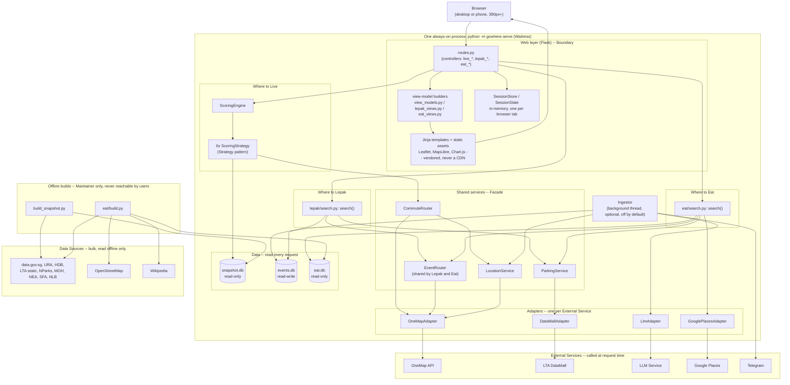

# System architecture

Built from the architectural decisions already recorded in prose in `DECISIONS.md` §4 — this is
that section as a diagram, not a new decision. Raw source also lives on its own at
[`architecture.mmd`](architecture.mmd).

## Notes

- **One process, not a microservice-per-feature split.** `DECISIONS.md` §4: "Two deployments is
  twice the operations work for a 5-week project." Session state in `SessionStore` lives in that
  one process's memory, which is why the deploy guidance in the README insists on a single instance
  with no autoscaling.
- **Two-tier data**: `snapshot.db` and `eat.db` are built offline and read-only at request time;
  `events.db` is the one store written at request time, by `Ingestor` on its own background thread.
  Splitting read-only from read-write data this way is what makes the Performance NFR achievable —
  a request never waits on a bulk Data Source, only (at most) on an External Service.
- **`EventRouter` crosses the Lepak/Eat boundary** deliberately — it's the one piece of this diagram
  that was written for one feature and reused unchanged by a feature that didn't exist yet when it
  was built, which is the Supportability NFR's reuse claim made visible as a diagram edge.
- **Every External Service sits behind its own Adapter.** `DECISIONS.md` §4: "Makes them mockable,
  which the test plan depends on." Swapping the LLM Service provider (Anthropic → OpenAI, partway
  through the project) only ever touched `LlmAdapter`.
