# System architecture

Built from the architectural decisions already recorded in prose in `DECISIONS.md` §4 — this is
that section as a diagram, not a new decision. Raw source also lives on its own at
[`architecture.mmd`](architecture.mmd).

```mermaid
flowchart TB
    Browser["Browser<br/>(desktop or phone, 390px+)"]

    subgraph Process["One always-on process: python -m gowhere.serve (Waitress)"]
        direction TB

        subgraph WebLayer["Web layer (Flask)"]
            Routes["routes.py<br/>(controllers: live_*, lepak_*, eat_*)"]
            Views["view-model builders<br/>view_models.py / lepak_views.py / eat_views.py"]
            Templates["Jinja templates + static assets<br/>Leaflet, MapLibre, Chart.js -- vendored, never a CDN"]
            Session["SessionStore / SessionState (control)<br/>in-memory, one per browser tab;<br/>owns that session's routers"]
        end

        subgraph LiveFeature["Where to Live"]
            Engine["ScoringEngine"]
            Strategies["6x ScoringStrategy<br/>(Strategy pattern)"]
        end

        subgraph LepakFeature["Where to Lepak"]
            LepakSearch["lepak/search.py: search()"]
        end

        subgraph EatFeature["Where to Eat"]
            EatSearch["eat/search.py: search(), browse()"]
            Ratings["eat/ratings.py: attach()"]
        end

        subgraph Shared["Shared services -- Facade"]
            Location["LocationService"]
            CommRouter["CommuteRouter"]
            EvRouter["EventRouter<br/>(shared by Lepak and Eat)"]
            Parking["ParkingService"]
        end

        subgraph AdapterLayer["Adapters -- one per External Service"]
            OneMap["OneMapAdapter"]
            DataMall["DataMallAdapter"]
            LLM["LlmAdapter"]
            Places["GooglePlacesAdapter"]
            Telegram["TelegramPostSource"]
        end

        Ingestor["Ingestor<br/>(background thread, optional, off by default)"]

        subgraph Stores["Data -- local files"]
            Snap[("snapshot.db<br/>read-only, queried per request")]
            Events[("events.db<br/>read-write, queried per request")]
            PlaceDb[("eat.db<br/>read-only, loaded into memory once")]
        end
    end

    subgraph Offline["Offline builds -- Maintainer only, never reachable by users"]
        Fetch["etl fetch + geocode<br/>(DataGovAdapter, DataMallAdapter,<br/>OverpassAdapter, OneMapAdapter)"]
        Refresh["build_snapshot.py"]
        EatBuild["eat/build.py<br/>+ notable.py, google_ids.py"]
        Images["lepak/images.py<br/>(venue photos)"]
    end

    subgraph Sources["Data Sources -- bulk, read offline only"]
        GovData["data.gov.sg, URA, HDB,<br/>LTA static, NParks, MOH, NEA, SFA, NLB"]
        OSM["OpenStreetMap (Overpass)"]
        Wiki["Wikipedia"]
    end

    subgraph External["External Services -- called while the app runs"]
        OneMapAPI["OneMap API"]
        DataMallAPI["LTA DataMall"]
        PlacesAPI["Google Places"]
        LLMAPI["LLM Service<br/>(Ingestor only)"]
        TelegramAPI["Telegram<br/>(Ingestor only)"]
    end

    Browser --> Routes
    Routes --> Views --> Templates --> Browser
    Routes --> Session

    Routes --> Engine
    Routes --> LepakSearch
    Routes --> EatSearch
    Routes --> Ratings

    Engine --> Strategies
    Strategies --> CommRouter
    Strategies --> Snap

    LepakSearch --> EvRouter
    LepakSearch --> Parking
    Routes --> Events

    EatSearch --> EvRouter
    EatSearch --> Parking
    Routes --> PlaceDb
    Ratings --> Places

    Session --> CommRouter
    Session --> Location
    Session --> EvRouter

    CommRouter --> Location
    CommRouter --> OneMap
    EvRouter --> OneMap
    Location --> OneMap
    Location -. "HDB postal codes<br/>when OneMap is down" .-> Snap
    Parking --> DataMall

    Ingestor --> Telegram
    Ingestor --> LLM
    Ingestor --> Location
    Ingestor --> Events

    OneMap --> OneMapAPI
    DataMall --> DataMallAPI
    LLM --> LLMAPI
    Places --> PlacesAPI
    Telegram --> TelegramAPI

    Fetch --> GovData
    Fetch --> OSM
    Fetch --> DataMallAPI
    Fetch -- "geocoding" --> OneMapAPI
    Fetch -- "data/raw" --> Refresh
    Fetch -- "data/raw" --> EatBuild
    Refresh --> Snap
    EatBuild -- "notability" --> Wiki
    EatBuild -- "place IDs only" --> PlacesAPI
    EatBuild --> PlaceDb
    Images --> Wiki
```

## Notes

- **One process, not a microservice-per-feature split.** `DECISIONS.md` §4: "Two deployments is
  twice the operations work for a 5-week project." Session state in `SessionStore` lives in that
  one process's memory, which is why the deploy guidance in the README insists on a single instance
  with no autoscaling.
- **Two-tier data**: `snapshot.db` and `eat.db` are built offline and read-only while the app runs
  (`eat.db`'s 8,600 places are loaded into memory once at startup; `snapshot.db` is queried per
  request). `events.db` is the one store written while the app runs, by `Ingestor` on its own
  background thread, never by a user's request.
  Splitting read-only from read-write data this way is what makes the Performance NFR achievable —
  a request never waits on a bulk Data Source, only (at most) on an External Service.
- **`EventRouter` crosses the Lepak/Eat boundary** deliberately — it's the one piece of this diagram
  that was written for one feature and reused unchanged by a feature that didn't exist yet when it
  was built, which is the Supportability NFR's reuse claim made visible as a diagram edge.
- **Every External Service sits behind its own Adapter.** `DECISIONS.md` §4: "Makes them mockable,
  which the test plan depends on." Telegram's adapter is `TelegramPostSource`, which wraps the
  scraper in `ingest/telegram.py`. The offline builds use adapters too (`DataGovAdapter`,
  `OverpassAdapter`, and `OneMapAdapter` for geocoding), shown inside the fetch box rather than
  drawn twice. Swapping the LLM Service provider (Anthropic → OpenAI, partway through the project)
  only ever touched `LlmAdapter`.
- **Only three External Services are called on a user's request**: OneMap (postal codes and
  routes), LTA DataMall (live carpark lots, drive mode only) and Google Places (ratings, after an
  Eat search, under a daily cap). The LLM Service and Telegram are called only by the background
  `Ingestor`.
