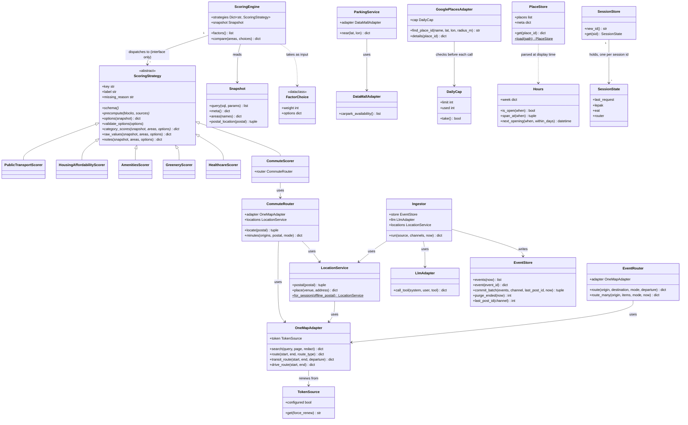

# Class diagram (design model)

Built from the real code in `gowhere/` (class and method names verified against source, not the
Lab 2 placeholder diagram, which predates most of the implementation and all of Where to Eat).
Raw source also lives on its own at [`class-diagram.mmd`](class-diagram.mmd).

## Notes

- **Why no `WhereToLiveUI`, `EventSearchController` etc.** (the Lab 2 placeholder boundary/control
  classes): the real web layer is Flask route functions (`gowhere/web/routes.py`) and view-model
  builder functions (`view_models.py`, `lepak_views.py`, `eat_views.py`), not classes. Wrapping them
  in classes would add indirection with no behaviour to justify it — `DECISIONS.md` §4 makes the same
  call explicitly ("Flask stays out of the way... where Django's conventions would fight it").
  These are shown as components in the architecture diagram instead.
- **Why no `Neighbourhood`, `Event`, `Place`, `Route`, `Carpark` entity classes**: these are rows
  from SQLite, carried as plain `dict`s all the way to the templates. A class with no behaviour
  beyond field access buys nothing a dict doesn't already give for free — the real entity-like
  classes that *do* exist (`FactorChoice`, `Hours`, `TokenSource`, `DailyCap`) all earn their keep
  with actual logic (`Hours.is_open`, `TokenSource.get`'s renewal, `DailyCap.take`'s daily reset).
- **`EventRouter` is shared** by both Where to Lepak and Where to Eat (`gowhere/lepak/search.py`
  and `gowhere/eat/search.py` each call `route_many` through their own instance) — the Supportability
  NFR's "added with only small additive changes at the shared seams" claim, in class form.
- **`ScoringEngine → ScoringStrategy` is "dispatches to (interface only)"**: the engine never
  imports a concrete scorer; `gowhere/scoring/registry.py` is what lists the six concrete classes.
  Adding a seventh factor touches that registry and nothing else.
