# Class diagram (design model)

Built from the real code in `gowhere/` (class and method names verified against source, not the
Lab 2 placeholder diagram, which predates most of the implementation and all of Where to Eat).
Raw source also lives on its own at [`class-diagram.mmd`](class-diagram.mmd).

**Reading the arrows** (standard UML; each one chosen from what the code does, not how it looks):

| Arrow | Relationship | In this diagram |
|---|---|---|
| solid line, hollow triangle | Generalization | the six scorers inherit `ScoringStrategy` |
| solid line, filled diamond on the whole | Composition: the whole creates the part, and the part goes when it goes | a session owns its routers; a router creates its own `OneMapAdapter`; a store holds its rows |
| solid line, hollow diamond on the whole | Aggregation: the part is made elsewhere or shared | the engine is handed its six strategies; every `OneMapAdapter` shares one `TokenSource` |
| solid line, open arrow | Association: a lasting reference kept in a field | `Ingestor` keeps its `EventStore`, `LlmAdapter` and `LocationService` |
| dashed line, open arrow | Dependency: used only during a call | a route calls a search; a search is passed the router; `EatHours` creates `Hours` |

```mermaid
classDiagram
    %% GoWhere design class model, built from the real code (gowhere/), not the Lab 2
    %% placeholder names. Every class carries its Fox/Bruegge stereotype and sits in a
    %% Boundary, Control or Entity group. A module of plain functions (web routes,
    %% lepak.search, eat.search, eat.ratings, eat.hours) also carries <<utility>>, UML's
    %% notation for free functions grouped in one place. An <<entity, table>> class is a
    %% database table whose rows the code carries as dicts. A <<boundary, page>> class is
    %% one screen: a Jinja template in gowhere/web/templates, matching a dialog map state.
    %% The view-model builders are left out: they only reshape results for the templates.

    namespace Boundary {
        class WebRoutes {
            <<boundary, utility>>
            +live_submit()
            +live_results()
            +lepak_submit()
            +lepak_event(event_id)
            +eat_submit()
            +eat_area(area)
            +eat_place(place_id)
        }
        class OneMapAdapter {
            <<boundary>>
            +tokens TokenSource
            +token bool
            +search(query, page, redact) dict
            +route(start, end, route_type) dict
            +transit_route(start, end, departure) dict
            +drive_route(start, end) dict
        }
        class TokenSource {
            <<boundary>>
            +configured bool
            +get(force_renew) str
        }
        class DataMallAdapter {
            <<boundary>>
            +carpark_availability() list
            +pages(endpoint, max_pages) list
        }
        class LlmAdapter {
            <<boundary>>
            +call_tool(system, user, tool) dict
        }
        class TelegramPostSource {
            <<boundary>>
            +posts(channel, since_post_id) list
        }
        class GooglePlacesAdapter {
            <<boundary>>
            +cap DailyCap
            +find_place_id(name, lat, lon, radius_m) str
            +details(place_id) dict
        }
        class DailyCap {
            <<boundary>>
            +limit int
            +used int
            +take() bool
        }
        class DataGovAdapter {
            <<boundary>>
            +datastore_pages(resource_id, page_size, filters) list
            +download_file(dataset_id, max_polls) dict
        }
        class OverpassAdapter {
            <<boundary>>
            +query(overpass_ql) dict
            +amenities(selectors, bbox) dict
        }
        class HomePage {
            <<boundary, page>>
            +links to the three features
        }
        class LiveSetupPage {
            <<boundary, page>>
            +areas
            +include, weight per factor
            +factor options
            +destination_postal, mode
        }
        class LiveResultsPage {
            <<boundary, page>>
            +ranking and recommendation
            +chart and map
            +breakdown dialog, UC-5
            +excluded factors
            +link to Where to Eat in each area
        }
        class LepakSetupPage {
            <<boundary, page>>
            +categories, date_option
            +origin postal or location
            +mode, max_minutes
        }
        class LepakResultsPage {
            <<boundary, page>>
            +events with travel time
            +sort, page
        }
        class EventDetailPage {
            <<boundary, page>>
            +route map and steps, UC-2
            +carparks in drive mode, UC-3
            +source posts
            +link to Where to Eat near the event
        }
        class EatSetupPage {
            <<boundary, page>>
            +cuisines, price tiers, when
            +origin postal or location
            +mode, max_minutes
        }
        class EatResultsPage {
            <<boundary, page>>
            +places with travel time and rating
            +sort, page
        }
        class EatAreaPage {
            <<boundary, page>>
            +places in one area, no routing
            +sort, page
        }
        class PlaceDetailPage {
            <<boundary, page>>
            +opening hours, rating
            +route map and steps
            +carparks in drive mode, UC-3
        }
        class ErrorPage {
            <<boundary, page>>
            +title, messages
            +link back to its feature
        }
    }

    namespace Control {
        class LepakSearch {
            <<control, utility>>
            +search(events, origin, categories, date_option, mode, max_minutes, router, now, parking) dict
            +sort_and_filter(results, sort, hidden, page) tuple
        }
        class EatSearch {
            <<control, utility>>
            +search(places, origin, cuisines, tiers, when, mode, max_minutes, router, now, parking) dict
            +browse(places, area, cuisines, tiers, now) list
            +sort_and_filter(results, sort, hidden, page, cuisine_filter) tuple
        }
        class EatRatings {
            <<control, utility>>
            +attach(results, adapter)
        }
        class EatHours {
            <<control, utility>>
            +parse(text) Hours
            +status(text, when) dict
        }
        class ScoringEngine {
            <<control>>
            +strategies Dict~str, ScoringStrategy~
            +snapshot Snapshot
            +factors() list
            +compare(areas, choices) dict
        }
        class ScoringStrategy {
            <<control, abstract>>
            +key str
            +label str
            +missing_reason str
            +option_labels dict
            +schema()*
            +precompute(blocks, sources)*
            +meta(sources) dict
            +options(snapshot) dict
            +validate_options(options)
            +category_scores(snapshot, areas, options)* dict
            +raw_values(snapshot, areas, options) dict
            +notes(snapshot, areas, options) dict
            +factor_notes(snapshot, options) list
        }
        class PublicTransportScorer {
            <<control>>
        }
        class HousingAffordabilityScorer {
            <<control>>
        }
        class AmenitiesScorer {
            <<control>>
        }
        class GreeneryScorer {
            <<control>>
        }
        class HealthcareScorer {
            <<control>>
        }
        class CommuteScorer {
            <<control>>
            +router CommuteRouter
        }
        class CommuteRouter {
            <<control>>
            +adapter OneMapAdapter
            +locations LocationService
            +locate(postal) tuple
            +minutes(origins, postal, mode) dict
        }
        class LocationService {
            <<control>>
            +adapter OneMapAdapter
            +offline_postal
            +postal(postal) tuple
            +place(venue, address) dict
            +for_session(offline_postal)$ LocationService
        }
        class EventRouter {
            <<control>>
            +adapter OneMapAdapter
            +route(origin, destination, mode, departure) dict
            +route_many(origin, items, mode, now, departure) dict
        }
        class ParkingService {
            <<control>>
            +adapter DataMallAdapter
            +near(lat, lon) dict
        }
        class Ingestor {
            <<control>>
            +store EventStore
            +llm LlmAdapter
            +locations LocationService
            +run(source, channels, now) dict
        }
        class SessionStore {
            <<control>>
            +new_id() str
            +get(sid) SessionState
        }
        class SessionState {
            <<control>>
            +router CommuteRouter
            +locations LocationService
            +event_router EventRouter
            +last_request
            +lepak
            +eat
            +eat_anchor
        }
    }

    namespace Entity {
        class Snapshot {
            <<entity>>
            +query(sql, params) list
            +meta() dict
            +areas(names) dict
            +postal_location(postal) tuple
        }
        class Neighbourhood {
            <<entity, table>>
            +name str
            +region str
            +in_scope bool
            +n_blocks int
            +n_flats int
            +small_sample bool
        }
        class HDBBlock {
            <<entity, table>>
            +id int
            +blk_no str
            +street str
            +postal str
            +lat float
            +lon float
            +planning_area str
            +total_dwelling_units int
        }
        class EventStore {
            <<entity>>
            +events(now) list
            +event(event_id) dict
            +commit_batch(events, channel, last_post_id, now) tuple
            +purge_ended(now) int
            +last_post_id(channel) int
        }
        class Event {
            <<entity, table>>
            +id int
            +title str
            +category str
            +start_at str
            +ends_at str
            +all_day bool
            +venue str
            +place_name str
            +lat float
            +lon float
            +summary str
        }
        class PlaceStore {
            <<entity>>
            +places list
            +meta dict
            +get(place_id) dict
            +load(path)$ PlaceStore
        }
        class Place {
            <<entity, table>>
            +id int
            +name str
            +kind str
            +stalls int
            +price_tier str
            +cuisines list
            +opening_hours str
            +lat float
            +lon float
            +planning_area str
            +wikipedia_title str
            +google_place_id str
        }
        class Hours {
            <<entity>>
            +week dict
            +is_open(when) bool
            +span_at(when) tuple
            +next_opening(when, within_days) datetime
        }
        class FactorChoice {
            <<entity, dataclass>>
            +weight int
            +options dict
        }
    }

    %% Arrows follow UML: <|-- generalization; *-- composition (filled diamond on the
    %% whole: it creates the part and the part dies with it); o-- aggregation (hollow
    %% diamond: the part is made elsewhere or shared); --> association (a lasting
    %% reference held in a field); ..> dependency (used only during a call: a parameter,
    %% a function call, or an object it creates and hands back).

    %% ==== Web layer: per-request use only ====
    WebRoutes ..> HomePage : renders
    WebRoutes ..> LiveSetupPage : renders
    WebRoutes ..> LiveResultsPage : renders
    WebRoutes ..> LepakSetupPage : renders
    WebRoutes ..> LepakResultsPage : renders
    WebRoutes ..> EventDetailPage : renders
    WebRoutes ..> EatSetupPage : renders
    WebRoutes ..> EatResultsPage : renders
    WebRoutes ..> EatAreaPage : renders
    WebRoutes ..> PlaceDetailPage : renders
    WebRoutes ..> ErrorPage : renders
    WebRoutes ..> SessionStore : looks up this browser's state
    WebRoutes ..> ScoringEngine : creates per request
    WebRoutes ..> LepakSearch : calls
    WebRoutes ..> EatSearch : calls
    WebRoutes ..> EatRatings : after each Eat search
    WebRoutes ..> EventStore : opens per request
    WebRoutes ..> PlaceStore : reads places
    WebRoutes ..> ParkingService : refreshes on a detail screen

    %% ==== Where to Lepak and Where to Eat: collaborators passed in as parameters ====
    LepakSearch ..> EventRouter : route_many
    LepakSearch ..> ParkingService : drive mode
    EatSearch ..> EventRouter : route_many
    EatSearch ..> ParkingService : drive mode
    EatSearch ..> EatHours : opening status
    EatHours ..> Hours : creates
    EatRatings ..> GooglePlacesAdapter : details

    %% ==== Where to Live: Strategy pattern ====
    ScoringStrategy <|-- PublicTransportScorer
    ScoringStrategy <|-- HousingAffordabilityScorer
    ScoringStrategy <|-- AmenitiesScorer
    ScoringStrategy <|-- GreeneryScorer
    ScoringStrategy <|-- HealthcareScorer
    ScoringStrategy <|-- CommuteScorer
    ScoringEngine "1" o-- "6" ScoringStrategy : dispatches to (interface only)
    ScoringEngine "*" --> "1" Snapshot : reads
    ScoringEngine ..> FactorChoice : takes as input
    CommuteScorer "*" --> "1" CommuteRouter : the session's router

    %% ==== Shared routing and location services ====
    CommuteRouter "1" *-- "1" OneMapAdapter
    CommuteRouter "1" *-- "1" LocationService : its own lookups
    LocationService "*" --> "1" OneMapAdapter : its own, or its router's
    LocationService ..> Snapshot : HDB postal codes when OneMap is down
    EventRouter "1" *-- "1" OneMapAdapter
    ParkingService "1" *-- "1" DataMallAdapter

    %% ==== Event ingestion (background, off by default) ====
    Ingestor ..> TelegramPostSource : reads posts from
    Ingestor "1" --> "1" LlmAdapter
    Ingestor "1" --> "1" LocationService
    Ingestor "1" --> "1" EventStore : writes

    %% ==== Adapters' helpers ====
    OneMapAdapter "*" o-- "1" TokenSource : one shared per process
    GooglePlacesAdapter "1" *-- "1" DailyCap

    %% ==== Stores and their rows ====
    Snapshot "1" *-- "*" Neighbourhood : planning_area rows
    Snapshot "1" *-- "*" HDBBlock : hdb_block rows
    HDBBlock "*" --> "1" Neighbourhood : planning_area
    ScoringStrategy ..> HDBBlock : precompute(blocks), one value per block
    EventStore "1" *-- "*" Event : event rows
    PlaceStore "1" *-- "*" Place : place rows
    Place ..> Hours : opening_hours parsed into

    %% ==== Per-browser-tab session state, in memory only ====
    SessionStore "1" *-- "*" SessionState : one per session id, dropped on expiry
    SessionState "1" *-- "1" CommuteRouter : Commute route cache
    SessionState "1" *-- "0..1" LocationService : created on first search
    SessionState "1" *-- "0..1" EventRouter : created on first search
```

## Notes

- **Boundary, Control, Entity.** Every class carries its Fox/Bruegge stereotype and sits in the
  matching group:
  - **Boundary**: the actors' side of the system. `WebRoutes` takes the User's requests and
    renders one `«boundary, page»` class per screen (a Jinja template: `HomePage` is
    `home.html`, `LiveSetupPage` is `live_setup.html`, and so on), the same screens as the
    dialog map's states; each Adapter is the system's interface to one External Service actor (OneMap, LTA DataMall, the
    LLM Service, Telegram, Google Places, data.gov.sg, Overpass). `TokenSource` and `DailyCap` are
    parts of their adapters.
  - **Control**: the use cases' logic: the scoring engine and its strategies, the Lepak and Eat
    searches, ratings, opening hours, the routers, `LocationService`, `ParkingService`,
    `Ingestor`, and the per-session state (`SessionStore`, `SessionState`; see below).
  - **Entity**: the information the system keeps, in its stores (`Snapshot`, `EventStore`,
    `PlaceStore`) and the rows they hold, including `HDBBlock`.
- **Lab 2's screen classes became page classes.** `WhereToLiveUI`, `WhereToGoUI` and
  `ScoreBreakdownUI` are now `LiveSetupPage`/`LiveResultsPage`, `LepakSetupPage`/`LepakResultsPage`
  and the breakdown dialog inside `LiveResultsPage`. Their attributes are what each screen collects
  or shows; they have no operations because a template has none (the user's actions are links and
  forms handled by `WebRoutes`).
- **No `ComparisonController` or `EventSearchController` wrapper classes** (the Lab 2 names):
  the real web layer is Flask route functions (`gowhere/web/routes.py`) and view-model builder
  functions (`view_models.py`, `lepak_views.py`, `eat_views.py`), not classes. Wrapping them in
  classes would add indirection with no behaviour to justify it — `DECISIONS.md` §4 makes the same
  call explicitly ("Flask stays out of the way... where Django's conventions would fight it").
  The function modules are drawn as `«utility»` classes instead (`WebRoutes` = `web/routes.py`,
  `LepakSearch` = `lepak/search.py`, `EatSearch` = `eat/search.py`, `EatRatings` = `eat/ratings.py`,
  `EatHours` = `eat/hours.py`). `«utility»` is UML's own notation for a module of free functions,
  so the diagram keeps its Boundary and Control roles without inventing classes the code doesn't
  have.
- **`Neighbourhood`, `HDBBlock`, `Event` and `Place` are `«entity, table»`**: each is a database
  table (`planning_area` and `hdb_block` in `snapshot.db`, `event` in `events.db`, `place` in
  `eat.db`), with the columns the app uses. The code carries each row as a plain `dict` all the way to the templates rather than
  wrapping it in a class: a class with no behaviour beyond field access buys nothing a dict doesn't
  already give. The entity classes that *do* exist in code (`FactorChoice`, `Hours`) earn their keep
  with actual logic (`Hours.is_open`). `Route` and `Carpark` aren't stored at all: they are built per
  request from OneMap and DataMall replies.
- **`EventRouter` is shared** by both Where to Lepak and Where to Eat: `gowhere/lepak/search.py`
  and `gowhere/eat/search.py` both call `route_many` on the same per-session instance
  (`SessionState.event_router`) — the Supportability NFR's "added with only small additive changes
  at the shared seams" claim, in class form.
- **`HDBBlock` is the unit of measurement.** Every factor is measured per block and weighted by
  `total_dwelling_units` (flats), not per Planning Area: each strategy's `precompute(blocks, …)`
  writes one row per block, keyed by `block_id`. This is the answer to the Lab 1 tutor feedback
  that a single area-level transport figure misrepresents a large area like Tampines.
- **`SessionStore` and `SessionState` are control, not entity.** They hold no information the
  system keeps: a session lives in memory for two hours and is gone on restart. What they do hold
  is that browser's control objects, so the use-case flow can continue across requests.
- **Each session owns its routers.** `SessionState` holds that browser's `CommuteRouter` (with its
  route cache), `LocationService` (its postal-code lookups) and `EventRouter`, in memory only
  (`DECISIONS.md` §17). That is why the app must run as one process.
- **Offline-only adapters.** `DataGovAdapter` and `OverpassAdapter` are used only by the offline data
  builds, never by the running app; `GooglePlacesAdapter.find_place_id` likewise runs only offline
  (`eat/google_ids.py`), while `details` runs at request time through `EatRatings`.
- **`TelegramPostSource`** (`ingest/run.py`) is the Telegram adapter: it wraps the scraper functions
  in `ingest/telegram.py`. `Ingestor.run` takes any object with `posts()`, so tests pass a
  `FilePostSource` instead.
- **`ScoringEngine → ScoringStrategy` is "dispatches to (interface only)"**: the engine never
  imports a concrete scorer; `gowhere/scoring/registry.py` is what lists the six concrete classes.
  Adding a seventh factor touches that registry and nothing else.
