# Class diagram (design model)

Built from the real code in `gowhere/` (class and method names verified against source, not the
Lab 2 placeholder diagram, which predates most of the implementation and all of Where to Eat).
Raw source also lives on its own at [`class-diagram.mmd`](class-diagram.mmd).

```mermaid
classDiagram
    %% GoWhere design class model, built from the real code (gowhere/), not the Lab 2
    %% placeholder names. Grouped by Fox/Bruegge stereotype. A module of plain functions
    %% (web routes, lepak.search, eat.search, eat.ratings, eat.hours) is drawn as a
    %% <<utility>> class, UML's notation for free functions grouped in one place. The
    %% view-model builders are left out: they only reshape results for the templates.

    %% ==== Web layer and feature logic: plain-function modules ====
    class WebRoutes {
        <<utility>>
        +live_submit()
        +live_results()
        +lepak_submit()
        +lepak_event(event_id)
        +eat_submit()
        +eat_area(area)
        +eat_place(place_id)
    }
    class LepakSearch {
        <<utility>>
        +search(events, origin, categories, date_option, mode, max_minutes, router, now, parking) dict
        +sort_and_filter(results, sort, hidden, page) tuple
    }
    class EatSearch {
        <<utility>>
        +search(places, origin, cuisines, tiers, when, mode, max_minutes, router, now, parking) dict
        +browse(places, area, cuisines, tiers, now) list
        +sort_and_filter(results, sort, hidden, page, cuisine_filter) tuple
    }
    class EatRatings {
        <<utility>>
        +attach(results, adapter)
    }
    class EatHours {
        <<utility>>
        +parse(text) Hours
        +status(text, when) dict
    }
    WebRoutes --> SessionStore : looks up this browser's state
    WebRoutes --> ScoringEngine : Where to Live
    WebRoutes --> LepakSearch : Where to Lepak
    WebRoutes --> EatSearch : Where to Eat
    WebRoutes --> EatRatings : after each Eat search
    WebRoutes --> EventStore : reads events
    WebRoutes --> PlaceStore : reads places
    WebRoutes --> ParkingService : refreshes on a detail screen
    LepakSearch --> EventRouter : route_many
    LepakSearch --> ParkingService : drive mode
    EatSearch --> EventRouter : route_many
    EatSearch --> ParkingService : drive mode
    EatSearch ..> EatHours : opening status
    EatHours ..> Hours : creates
    EatRatings --> GooglePlacesAdapter : details

    %% ==== Strategy: Where to Live scoring ====
    class ScoringStrategy {
        <<abstract>>
        +key str
        +label str
        +missing_reason str
        +option_labels dict
        +schema()*
        +precompute(blocks, sources)*
        +meta(sources) dict
        +options(snapshot) dict
        +validate_options(options)
        +category_scores(snapshot, areas, options)* dict
        +raw_values(snapshot, areas, options) dict
        +notes(snapshot, areas, options) dict
        +factor_notes(snapshot, options) list
    }
    class PublicTransportScorer
    class HousingAffordabilityScorer
    class AmenitiesScorer
    class GreeneryScorer
    class HealthcareScorer
    class CommuteScorer {
        +router CommuteRouter
    }
    ScoringStrategy <|-- PublicTransportScorer
    ScoringStrategy <|-- HousingAffordabilityScorer
    ScoringStrategy <|-- AmenitiesScorer
    ScoringStrategy <|-- GreeneryScorer
    ScoringStrategy <|-- HealthcareScorer
    ScoringStrategy <|-- CommuteScorer

    class ScoringEngine {
        +strategies Dict~str, ScoringStrategy~
        +snapshot Snapshot
        +factors() list
        +compare(areas, choices) dict
    }
    ScoringEngine "1" --> "6" ScoringStrategy : dispatches to (interface only)
    ScoringEngine --> Snapshot : reads
    ScoringEngine ..> FactorChoice : takes as input

    class FactorChoice {
        <<dataclass>>
        +weight int
        +options dict
    }

    %% ==== Control: shared routing and location services ====
    class CommuteRouter {
        +adapter OneMapAdapter
        +locations LocationService
        +locate(postal) tuple
        +minutes(origins, postal, mode) dict
    }
    CommuteScorer --> CommuteRouter : uses
    CommuteRouter --> OneMapAdapter : uses
    CommuteRouter --> LocationService : uses

    class LocationService {
        +adapter OneMapAdapter
        +offline_postal
        +postal(postal) tuple
        +place(venue, address) dict
        +for_session(offline_postal)$ LocationService
    }
    LocationService --> OneMapAdapter : uses
    LocationService ..> Snapshot : HDB postal codes when OneMap is down

    class EventRouter {
        +adapter OneMapAdapter
        +route(origin, destination, mode, departure) dict
        +route_many(origin, items, mode, now, departure) dict
    }
    EventRouter --> OneMapAdapter : uses

    class ParkingService {
        +adapter DataMallAdapter
        +near(lat, lon) dict
    }
    ParkingService --> DataMallAdapter : uses

    %% ==== Control: event ingestion (background, off by default) ====
    class Ingestor {
        +store EventStore
        +llm LlmAdapter
        +locations LocationService
        +run(source, channels, now) dict
    }
    Ingestor ..> TelegramPostSource : reads posts from
    Ingestor --> LlmAdapter : uses
    Ingestor --> LocationService : uses
    Ingestor --> EventStore : writes

    %% ==== Adapter: external services, one per service ====
    class OneMapAdapter {
        +tokens TokenSource
        +token bool
        +search(query, page, redact) dict
        +route(start, end, route_type) dict
        +transit_route(start, end, departure) dict
        +drive_route(start, end) dict
    }
    class TokenSource {
        +configured bool
        +get(force_renew) str
    }
    OneMapAdapter --> TokenSource : renews from

    class DataMallAdapter {
        +carpark_availability() list
        +pages(endpoint, max_pages) list
    }

    class LlmAdapter {
        +call_tool(system, user, tool) dict
    }

    class TelegramPostSource {
        +posts(channel, since_post_id) list
    }

    class GooglePlacesAdapter {
        +cap DailyCap
        +find_place_id(name, lat, lon, radius_m) str
        +details(place_id) dict
    }
    class DailyCap {
        +limit int
        +used int
        +take() bool
    }
    GooglePlacesAdapter --> DailyCap : checks before each call

    %% Offline only: used by the data builds, never at request time
    class DataGovAdapter {
        +datastore_pages(resource_id, page_size, filters) list
        +download_file(dataset_id, max_polls) dict
    }
    class OverpassAdapter {
        +query(overpass_ql) dict
        +amenities(selectors, bbox) dict
    }

    %% ==== Container / store: persistent data ====
    class Snapshot {
        +query(sql, params) list
        +meta() dict
        +areas(names) dict
        +postal_location(postal) tuple
    }
    class EventStore {
        +events(now) list
        +event(event_id) dict
        +commit_batch(events, channel, last_post_id, now) tuple
        +purge_ended(now) int
        +last_post_id(channel) int
    }
    class PlaceStore {
        +places list
        +meta dict
        +get(place_id) dict
        +load(path)$ PlaceStore
    }

    class Hours {
        +week dict
        +is_open(when) bool
        +span_at(when) tuple
        +next_opening(when, within_days) datetime
    }

    %% ==== Entity: per-browser-tab session state, in memory only ====
    class SessionStore {
        +new_id() str
        +get(sid) SessionState
    }
    class SessionState {
        +router CommuteRouter
        +locations LocationService
        +event_router EventRouter
        +last_request
        +lepak
        +eat
        +eat_anchor
    }
    SessionStore "1" --> "*" SessionState : holds, one per session id
    SessionState "1" --> "1" CommuteRouter : owns (Commute route cache)
    SessionState "1" --> "0..1" LocationService : owns, created on first search
    SessionState "1" --> "0..1" EventRouter : owns, created on first search
```

## Notes

- **Why no `WhereToLiveUI`, `EventSearchController` etc.** (the Lab 2 placeholder boundary/control
  classes): the real web layer is Flask route functions (`gowhere/web/routes.py`) and view-model
  builder functions (`view_models.py`, `lepak_views.py`, `eat_views.py`), not classes. Wrapping them
  in classes would add indirection with no behaviour to justify it — `DECISIONS.md` §4 makes the same
  call explicitly ("Flask stays out of the way... where Django's conventions would fight it").
  The function modules are drawn as `«utility»` classes instead (`WebRoutes` = `web/routes.py`,
  `LepakSearch` = `lepak/search.py`, `EatSearch` = `eat/search.py`, `EatRatings` = `eat/ratings.py`,
  `EatHours` = `eat/hours.py`). `«utility»` is UML's own notation for a module of free functions,
  so the diagram shows who calls `EventRouter`, `ParkingService` and the stores without inventing
  classes the code doesn't have.
- **Why no `Neighbourhood`, `Event`, `Place`, `Route`, `Carpark` entity classes**: these are rows
  from SQLite, carried as plain `dict`s all the way to the templates. A class with no behaviour
  beyond field access buys nothing a dict doesn't already give for free — the real entity-like
  classes that *do* exist (`FactorChoice`, `Hours`, `TokenSource`, `DailyCap`) all earn their keep
  with actual logic (`Hours.is_open`, `TokenSource.get`'s renewal, `DailyCap.take`'s daily reset).
- **`EventRouter` is shared** by both Where to Lepak and Where to Eat: `gowhere/lepak/search.py`
  and `gowhere/eat/search.py` both call `route_many` on the same per-session instance
  (`SessionState.event_router`) — the Supportability NFR's "added with only small additive changes
  at the shared seams" claim, in class form.
- **Each session owns its routers.** `SessionState` holds that browser's `CommuteRouter` (with its
  route cache), `LocationService` (its postal-code lookups) and `EventRouter`, in memory only
  (`DECISIONS.md` §17). That is why the app must run as one process.
- **Offline-only adapters.** `DataGovAdapter` and `OverpassAdapter` are used only by the offline data
  builds, never by the running app; `GooglePlacesAdapter.find_place_id` likewise runs only offline
  (`eat/google_ids.py`), while `details` runs at request time through `EatRatings`.
- **`TelegramPostSource`** (`ingest/run.py`) is the Telegram adapter: it wraps the scraper functions
  in `ingest/telegram.py`. `Ingestor.run` takes any object with `posts()`, so tests pass a
  `FilePostSource` instead.
- **`ScoringEngine → ScoringStrategy` is "dispatches to (interface only)"**: the engine never
  imports a concrete scorer; `gowhere/scoring/registry.py` is what lists the six concrete classes.
  Adding a seventh factor touches that registry and nothing else.
