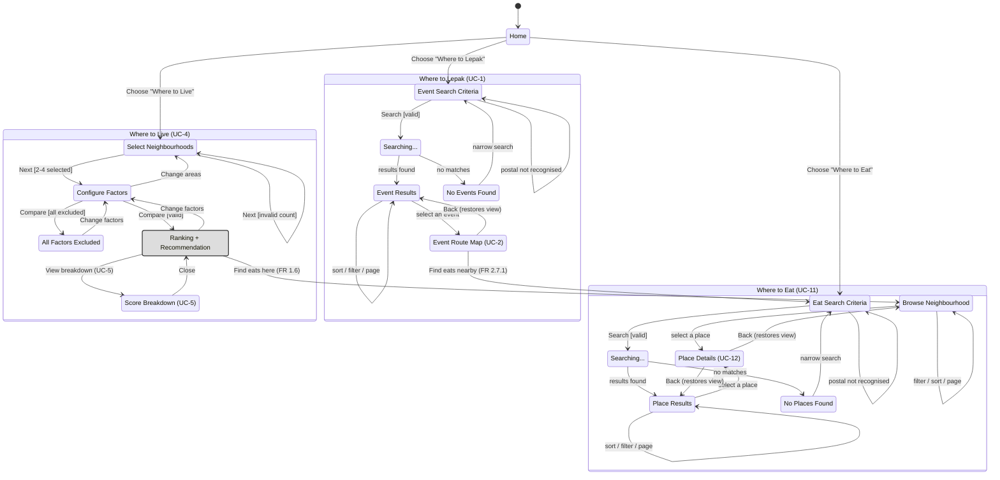

# Dialog map

A state machine of UI screens (Fox, Dialog Maps), extending the Lab 2 dialog map to all three
features. Built from the use case descriptions in `docs/deliverable/lab4_deliverable_FR_NFR.docx`
(UC-1 through UC-13) and cross-checked against `gowhere/web/routes.py`. Screens only — the detail
behind each box and arrow (exact FRs, exceptions, wording) lives in the use case descriptions, not
duplicated here.

Not shown: UC-9, UC-10 and UC-13 (Maintainer-only or scheduled background work, no screen of their
own), and UC-3, UC-6, UC-7, UC-8 (internal `«include»`s — a parking line, a commute score, a route —
that show up inline on the screens below rather than as screens themselves).

## Notes

- **Map picker / category wheel are not states.** Both drive the same form as the equivalent
  checkbox list — one state either way, same as the Lab 2 map didn't draw a separate state for a
  dropdown versus a text field.
- **`No Events Found` / `No Places Found`** replace Lab 2's `Too Many Events`: the current system no
  longer refuses above a cap, it routes the 25 nearest and says how many were in reach, so there's
  no longer a dead-end screen for that case.
- **`Place Details` is one screen, reached two ways** (UC-12): with a route, from `Place Results`;
  without one, from `Browse`. Same box, same as the diagram shows it.
- **Two edges are new since Lab 2**: `Ranking -> Browse` and `Event Route -> Eat Criteria`, both
  added for the third feature. Everything else is unchanged in shape from the two-feature version,
  just relabelled where the FR numbers moved.
