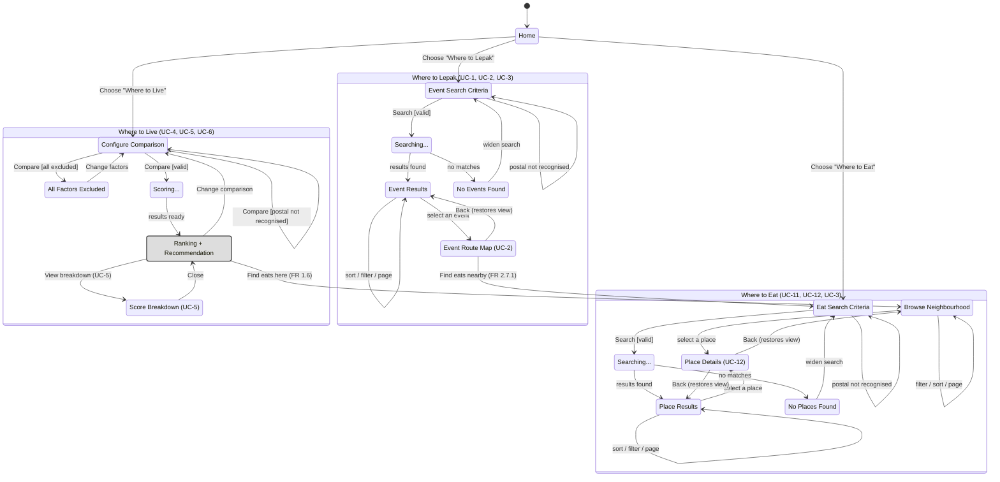

# Dialog map

A state machine of UI screens (Fox, Dialog Maps), extending the Lab 2 dialog map to all three
features. Built from the use case descriptions in `docs/deliverable/lab4_deliverable_FR_NFR.docx`
(UC-1 through UC-13) and cross-checked against `gowhere/web/routes.py` and the templates. Screens
only — the detail behind each box and arrow (exact FRs, exceptions, wording) lives in the use case
descriptions, not duplicated here.

The raw Mermaid source below also lives on its own at [`dialog-map.mmd`](dialog-map.mmd) — paste it
into the [Mermaid Live Editor](https://mermaid.live) to re-render or export it (PNG, SVG, PDF)
without needing this repo checked out.

Not shown: UC-9, UC-10 and UC-13 (Maintainer-only or scheduled background work, no screen of their
own), and UC-3 Check Parking, UC-6 Estimate Commute, UC-7 Plan Route, UC-8 Resolve Location
(internal `«include»`s with no screen of their own either — UC-3 is extra content on a results
screen when the travel mode is drive, UC-6 is backend scoring, UC-7/UC-8 are routing plumbing).

## Notes

- **The persistent header** (`GoWhere` · `Where to Live` · `Where to Lepak` · `Where to Eat`) is on
  every screen in this diagram and jumps straight to `Home` or any feature's entry state from
  anywhere. Not drawn as edges from all eleven states — that's the one thing this map leaves to the
  header rather than to an arrow.
- **`Configure Comparison` is one screen**, not two: the built `/live` page is a single form —
  the neighbourhood picker, all six factor panels and Compare together — so there's no separate
  "select neighbourhoods" step to transition out of.
- **Map picker / category wheel are not states.** Both drive the same form as the equivalent
  checkbox list — one state either way.
- **`No Events Found` / `No Places Found`** replace Lab 2's `Too Many Events`: the current system no
  longer refuses above a cap, it routes the 25 nearest and says how many were in reach, so there's
  no longer a dead-end screen for that case.
- **`Place Details` is one screen, reached two ways** (UC-12): with a route, from `Place Results`;
  without one, from `Browse`.
- **FR 1.4.3** ("nearly tied") is a wording detail on the `Ranking` screen, not a state of its own,
  so it isn't drawn separately.
- **Two edges are new since Lab 2**: `Ranking -> Browse` and `Event Route -> Eat Criteria`, both
  added for the third feature.
