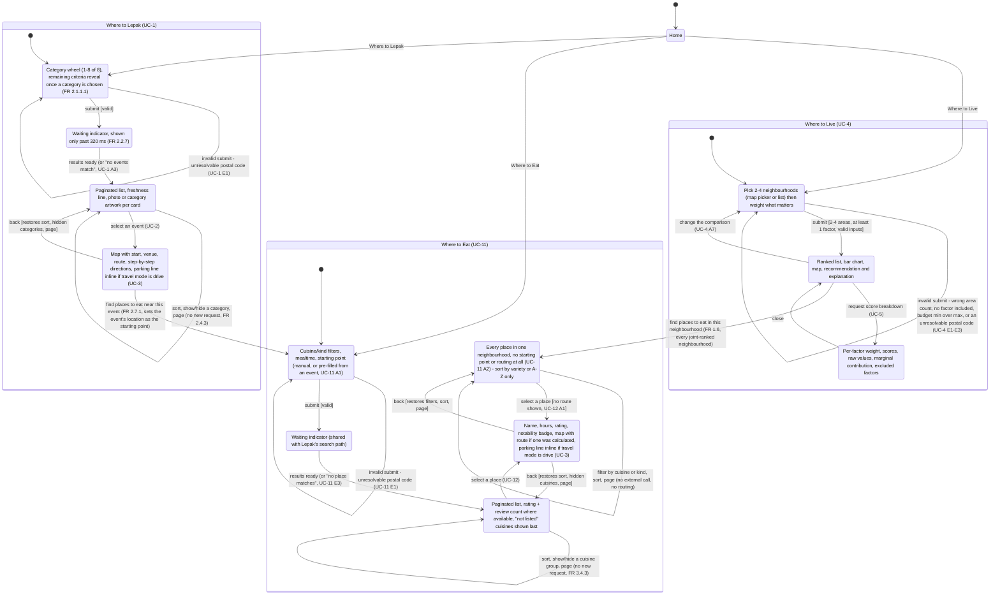

# Dialog map

A state machine of UI screens (Fox, Dialog Maps), built from `docs/deliverable/lab4_deliverable_FR_NFR.docx`
(use case descriptions UC-1 through UC-13, revised 26 Oct 2026) and cross-checked against the
routes in `gowhere/web/routes.py`. Supersedes the two-feature dialog map in the Lab 2 deliverable.

**Scope:** User-facing screens only. UC-9 Refresh Static Data, UC-10 Ingest Events and UC-13 Build
Place List are Maintainer-initiated or system-scheduled background procedures with no screen of
their own — they produce the data the screens below read, but neither a User nor this map ever
sees them run. UC-3 Check Parking, UC-6 Estimate Commute, UC-7 Plan Route and UC-8 Resolve Location
are internal `«include»`s with no screen either; their effect (a parking line, a commute score, a
route) shows up inline on the screens that invoke them, noted where relevant below.

## Notes

- **The map picker and the category wheel are not separate states.** Both are presentation over
  the same form state as the equivalent checkbox list — `LiveSetup` and `LepakSetup` work
  identically with JavaScript disabled, just rendered as a list instead of a map or a wheel. A
  dialog map models screens, not widgets, so this is one state either way.
- **The persistent header** (`GoWhere` · `Where to Live` · `Where to Lepak` · `Where to Eat`) is on
  every page and jumps straight to `Home`, `LiveSetup`, `LepakSetup` or `EatSetup` from anywhere in
  the diagram. Drawing that from all eleven states would make the diagram unreadable, so it's noted
  once here instead of as fourty-some edges.
- **`EatPlaceDetails` is one state reached two ways**, matching UC-12 exactly: from `EatResults`
  with a calculated route, or from `EatBrowse` with no route at all (UC-12 A1) — same screen,
  conditionally missing the map's route layer and the travel-time line.
- **Two cross-feature edges are new since the two-feature dialog map**: `LiveResults -> EatBrowse`
  (FR 1.6) and `LepakEventRoute -> EatSetup` (FR 2.7.1). Both exist because Where to Eat was added
  after Where to Live and Where to Lepak already worked — UC-11's two alternative entries (A1, A2)
  are what make them possible without Where to Eat needing to know anything about the other two
  features beyond a location and a name.
- **`LepakSearching` and `EatSearching`** are genuinely transient — UC-1 and UC-11 share the same
  routing path (`«include» UC-7 Plan Route`) and the same 8-second 90th-percentile target, so the
  waiting indicator is one shared piece of UI, not two.
