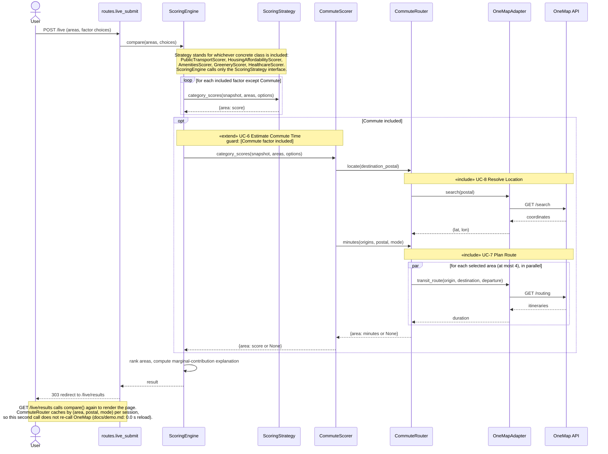
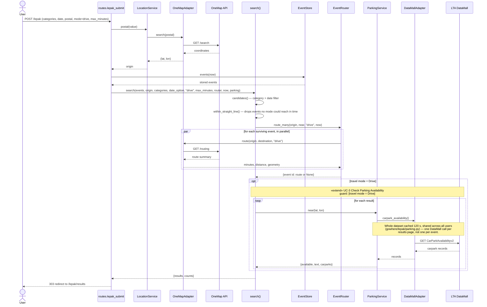
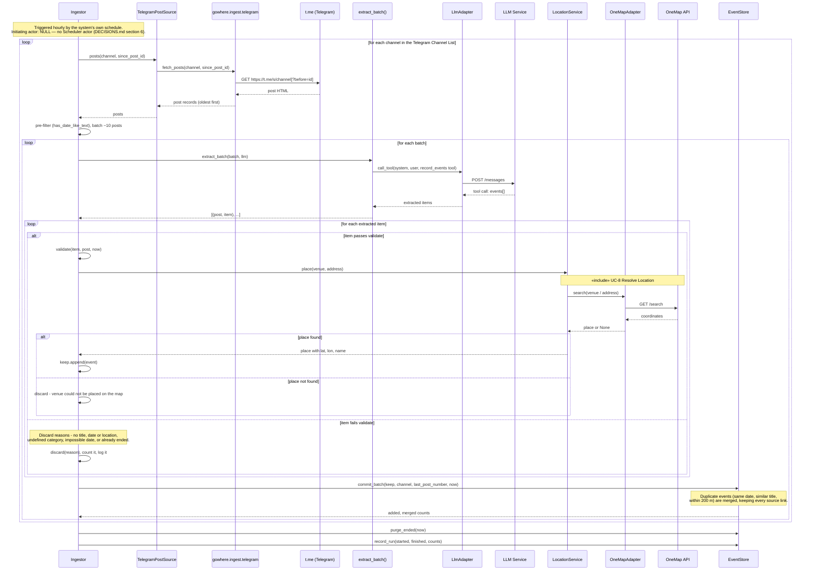

# Sequence diagrams (S4)

Three diagrams, built against the code as it stands today (`gowhere/`), not the Lab 1
design — class and method names below are copy-checked against the source files named
in each section. UC IDs refer to the Use Case diagram in the Lab 2 deliverable
(`SC2006 Lab2 deliverables.pdf`).

---

## 1. Compare Neighbourhoods with Commute

**UC-4 Compare Neighbourhoods**, extended by **UC-6 Estimate Commute Time** (guard:
Commute factor included), which includes **UC-7 Plan Route**, which includes
**UC-8 Resolve Location**. Sources: `gowhere/web/routes.py` (`live_submit`),
`gowhere/scoring/engine.py` (`ScoringEngine`), `gowhere/scoring/commute.py`
(`CommuteScorer`, `CommuteRouter`), `gowhere/adapters/onemap.py` (`OneMapAdapter`).

**Notes**

- A per-area routing failure returns `None` for that area; the engine then drops
  Commute for every selected area (`ScoringEngine.compare`'s `missing` check) rather
  than only for the one that failed — this is why the factor is "has no data for any
  selected area → dropped for all" in `DECISIONS.md` section 2.
- Routing is parallel (`ThreadPoolExecutor`, `CommuteRouter.minutes`), at most 4 calls
  per comparison (`CommuteRouter.max_workers=4`), far under OneMap's rate limit.

---

## 2. Find Events in Drive Mode

**UC-1 Find Events**, extended by **UC-3 Check Parking Availability** (guard: travel
mode = Drive). Two external services: OneMap API (routing, and resolving the postal
starting point) and LTA DataMall (parking). Sources: `gowhere/web/routes.py`
(`lepak_submit`), `gowhere/lepak/search.py` (`search`), `gowhere/lepak/routing.py`
(`EventRouter`), `gowhere/lepak/parking.py` (`ParkingService`),
`gowhere/adapters/datamall.py` (`DataMallAdapter`).

**Notes**

- Events OneMap could not route (`route is None`) are still kept, marked with their
  straight-line distance as an estimate, and sorted last — never hidden
  (`gowhere/lepak/search.py` docstring, `travel_text` in `lepak_views.py`).
- A DataMall failure (no key, outage, bad reply) returns the same
  `"Parking information unavailable"` for every event and never blocks the results
  from showing (`ParkingService._all`, `UNAVAILABLE`).

---

## 3. Ingest Events

**UC-10 Ingest Events** — initiating actor **NULL** (system-triggered hourly; per
`DECISIONS.md` section 6, no Scheduler actor is drawn, since a scheduler is internal
to the system). Includes **UC-8 Resolve Location** when placing a venue. Sources:
`gowhere/ingest/run.py` (`Ingestor`, `TelegramPostSource`), `gowhere/ingest/telegram.py`
(`fetch_posts`), `gowhere/ingest/extract.py` (`extract_batch`, `validate`, `Discard`),
`gowhere/adapters/llm.py` (`LlmAdapter`).

**Notes**

- If the LLM call fails (`LlmError`) or OneMap fails while placing a venue
  (`HttpError`), the whole batch is dropped and the channel's marker is **not**
  advanced — those posts are retried on the next run, never skipped
  (`Ingestor._batch`'s `return False` paths).
- Raw post text and the identity of the poster are never stored; only the extracted
  event fields and the source link are (`EventStore.commit_batch`, FR 3.2.6).
