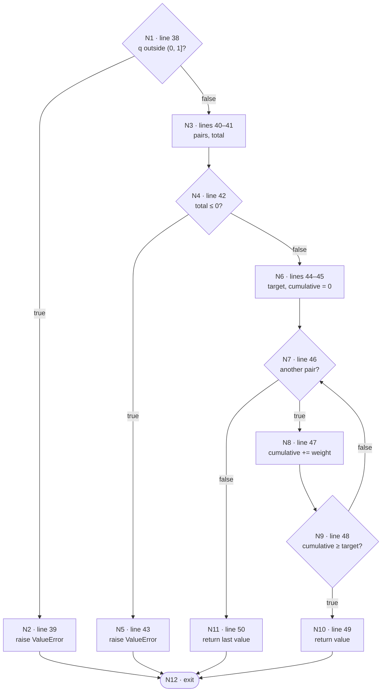
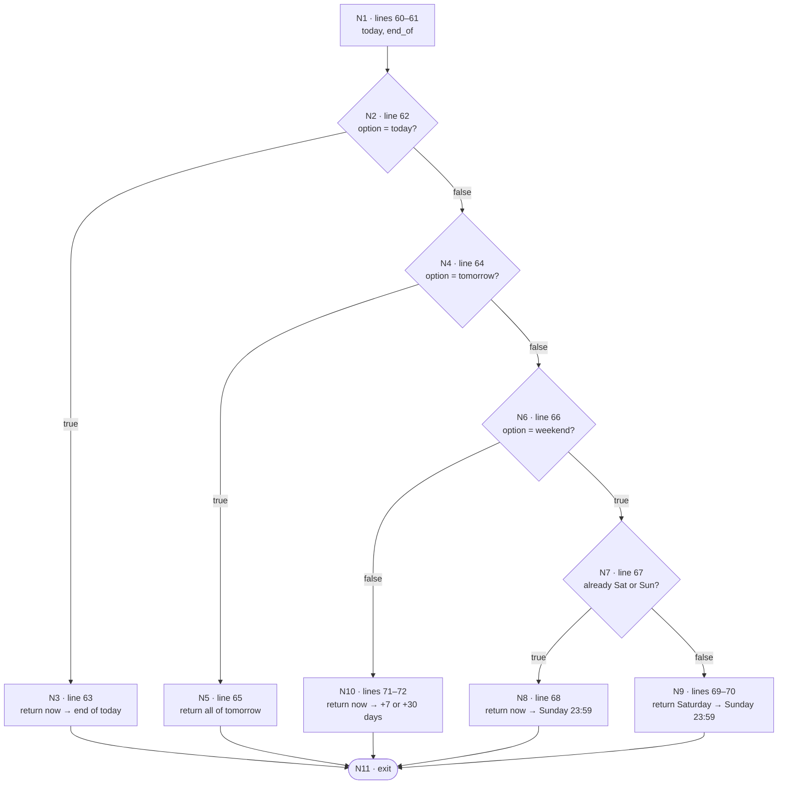

# White-box testing: basis path (Lab 4 §3.2.2, §3.2.3)

Basis path testing of two methods with real application logic (Lectures 19–21).

- **Automated test:** `tests/test_basis_path.py`. Test ids (`WQ-n`, `DW-n`) match the tables below.
- **Run:** `pytest tests/test_basis_path.py -v`.
- **Executed:** 2 Nov 2026, commit `fb927c7` plus the test file. **9 of 9 pass.**

**CFG conventions, as in the lecture's `computeP` example:**
- Consecutive statements with no branch form one node.
- A call such as `sorted(...)` or `max(...)` is one statement.
- `raise` and `return` lead to the exit node.
- Every decision is binary, so both formulas below give the same answer:
  - CC = |edges| − |nodes| + 2
  - CC = |decision points| + 1

**Why these two methods.** Each is the core of one feature. A defect in either gives users
a wrong answer without any error.

| Method | Feature | What it decides |
|---|---|---|
| `weighted_quantile` (`gowhere/scoring/stats.py`) | Where to Live | The flat-weighted median and P90 behind the Public Transport, Greenery and Healthcare scores (Accuracy NFR: scores must match a hand calculation) |
| `date_window` (`gowhere/lepak/search.py`) | Where to Lepak | The from–to time range for Today / Tomorrow / This weekend / Next 7 / Next 30 days (FR 2.1.3), including the rule that "this weekend" on a Saturday starts now |

---

## Method 1: `weighted_quantile(values, weights, q)`

```python
32  def weighted_quantile(values, weights, q):
38      if not 0 < q <= 1:                                   # D1
39          raise ValueError("q must be in (0, 1]")
40      pairs = sorted(zip(values, weights))
41      total = sum(w for _, w in pairs)
42      if total <= 0:                                       # D2
43          raise ValueError("weights must sum to a positive number")
44      target = Fraction(str(q)) * total
45      cumulative = 0
46      for value, weight in pairs:                          # D3
47          cumulative += weight
48          if cumulative >= target:                         # D4
49              return value
50      return pairs[-1][0]
```

### Control flow graph



### Cyclomatic complexity

- **Edges:** 15
  - N1→N2, N1→N3, N2→N12, N3→N4, N4→N5, N4→N6, N5→N12, N6→N7
  - N7→N8, N7→N11, N8→N9, N9→N10, N9→N7, N10→N12, N11→N12
- **Nodes:** 12
- **CC = 15 − 12 + 2 = 5**
- **Check:** 4 binary decisions (N1, N4, N7, N9), so CC = 4 + 1 = 5.

### Basis paths

The baseline is the most typical path: a valid request whose target is reached on the first
pair. Each later path flips one decision of the baseline, in order (Lecture 21). For the loop,
the lecture's rule is to take it zero times and once.

| Path | Decisions | Nodes | Feasible? |
|---|---|---|---|
| WQ-1 (baseline) | D1 F, D2 F, D3 T, D4 T | 1-3-4-6-7-8-9-10-12 | Yes |
| WQ-2 | **D1 T** | 1-2-12 | Yes |
| WQ-3 | D1 F, **D2 T** | 1-3-4-5-12 | Yes |
| WQ-4 | D1 F, D2 F, **D3 F** (loop not entered) | 1-3-4-6-7-11-12 | **No** |
| WQ-5 | D1 F, D2 F, D3 T, **D4 F**, D3 T, D4 T | 1-3-4-6-7-8-9-7-8-9-10-12 | Yes |

**WQ-4 is infeasible.** This is the lecture's warning: "a basis path may not be feasible regardless of input parameters".
- Entering N11 needs the loop to end without returning. That can happen in two ways, and neither can occur:
  - **The list is empty.** Then the total weight is 0, so N4 raises first.
  - **The loop runs out of pairs.** After the last pair, `cumulative` equals `total`. Because q ≤ 1, `target ≤ total`, so N9 is already true at the last pair at the latest.
- So **line 50 can never run.** It is a defensive fallback.
- A branch-coverage report (CI proposal 2) will flag it as never taken. That is expected, and this analysis is the explanation.

### Test cases and results

| ID | Path | Input (values; weights; q) | Expected (oracle) | Actual (log) | Result |
|---|---|---|---|---|---|
| WQ-1 | baseline | [5, 15]; [100, 100]; 0.5 | 5 (target 100 reached at the first pair; the docstring's example) | 5 | ok Pass |
| WQ-2 | D1 flipped | [5, 15]; [100, 100]; 0 | ValueError "q must be in (0, 1]" | same | ok Pass |
| WQ-3 | D2 flipped | [5, 15]; [0, 0]; 0.5 | ValueError "weights must sum to a positive number" | same | ok Pass |
| WQ-4 | D3 flipped | — | infeasible, no test | — | — |
| WQ-5 | D4 flipped | [10, 20, …, 100]; ten weights of 1; 0.9 | 90 (P90: target 9 reached at the 9th pair) | 90 | ok Pass |

**4 tests cover all 5 basis paths that can run.** That gives 100 % statement and branch
coverage of the reachable code, which is the lecture's guarantee for a basis set. Only line
50 and the N7-false edge are left uncovered, and they are the infeasible ones.

---

## Method 2: `date_window(option, now)`

```python
58  def date_window(option, now):
60      today = datetime.combine(now.date(), time(0, 0))
61      end_of = lambda d: datetime.combine(d.date(), time(23, 59))
62      if option == "today":                                # D1
63          return now, end_of(now)
64      if option == "tomorrow":                             # D2
65          return today + timedelta(days=1), end_of(today + timedelta(days=1))
66      if option == "weekend":                              # D3
67          if now.weekday() >= 5:                           # D4  already Sat or Sun
68              return now, end_of(today + timedelta(days=6 - now.weekday()))
69          saturday = today + timedelta(days=5 - now.weekday())
70          return saturday, end_of(saturday + timedelta(days=1))
71      days = {"week": 7, "month": 30}[option]
72      return now, end_of(today + timedelta(days=days))
```

### Control flow graph



### Cyclomatic complexity

- **Edges:** 14
  - N1→N2, N2→N3, N2→N4, N3→N11, N4→N5, N4→N6, N5→N11
  - N6→N7, N6→N10, N7→N8, N7→N9, N8→N11, N9→N11, N10→N11
- **Nodes:** 11
- **CC = 14 − 11 + 2 = 5**
- **Check:** 4 binary decisions (N2, N4, N6, N7), so CC = 4 + 1 = 5.

### Basis paths

The baseline is "this weekend" asked on a weekday. It is the most-used option, and it runs
the only date arithmetic that depends on the day of the week.

| Path | Decisions | Nodes |
|---|---|---|
| DW-1 (baseline) | D1 F, D2 F, D3 T, D4 F | 1-2-4-6-7-9-11 |
| DW-2 | **D1 T** | 1-2-3-11 |
| DW-3 | D1 F, **D2 T** | 1-2-4-5-11 |
| DW-4 | D1 F, D2 F, **D3 F** | 1-2-4-6-10-11 |
| DW-5 | D1 F, D2 F, D3 T, **D4 T** | 1-2-4-6-7-8-11 |

All five are feasible.

### Test cases and results

`now` is Wednesday 4 Nov 2026 15:30 unless stated.

| ID | Path | Input | Expected (oracle) | Actual (log) | Result |
|---|---|---|---|---|---|
| DW-1 | baseline | weekend, Wednesday | Sat 7 Nov 00:00 → Sun 8 Nov 23:59 | same | ok Pass |
| DW-2 | D1 flipped | today | Wed 4 Nov 15:30 → Wed 4 Nov 23:59 | same | ok Pass |
| DW-3 | D2 flipped | tomorrow | Thu 5 Nov 00:00 → Thu 5 Nov 23:59 | same | ok Pass |
| DW-4 | D3 flipped | week | Wed 4 Nov 15:30 → Wed 11 Nov 23:59 | same | ok Pass |
| DW-5 | D4 flipped | weekend, **Saturday 7 Nov 15:30** | Sat 7 Nov 15:30 → Sun 8 Nov 23:59 (an event earlier on Saturday is over, so it is not shown) | same | ok Pass |

**5 tests for 5 basis paths: 100 % statement and branch coverage.**

**Not a branch, so not a basis path.** An option that is none of the five raises `KeyError` at line 71 (a dictionary lookup).
- `lepak/search.py validate()` rejects it before `date_window` is called.
- That rule is black-box territory and is covered in `tests/test_lepak_search.py`.

---

## Why so few tests (§3.2.3)

- **All paths:** the loop in `weighted_quantile` can run any number of times, so the number
  of complete paths has no fixed limit.
- **Basis paths:** CC = 5 for each method is the upper bound on the basis set.
  - `date_window`: all 5 basis paths can run, so 5 tests.
  - `weighted_quantile`: 1 basis path is infeasible, so 4 tests.
- **9 tests in total** reach full statement and branch coverage of every reachable line in both methods.
